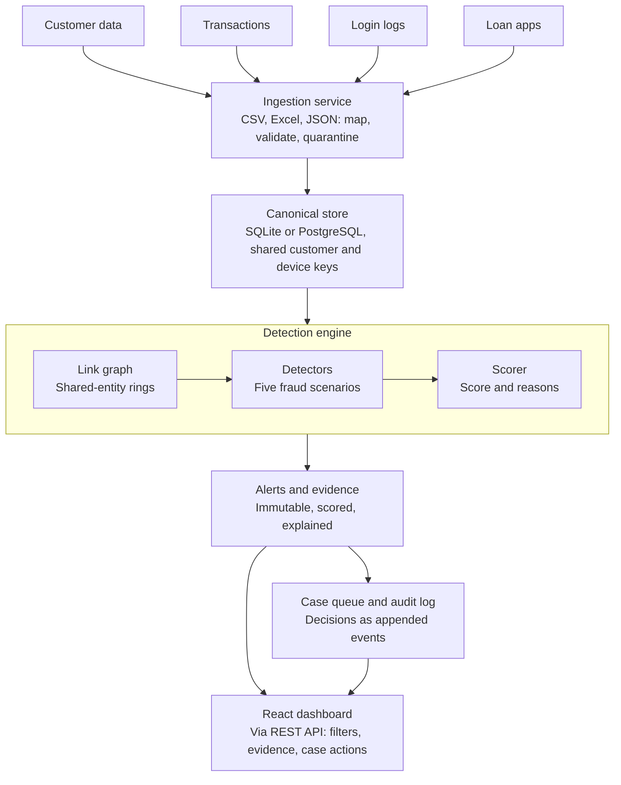

# System Architecture: Digital Fraud Investigation System

Data flows one way: source files are validated into a shared store, a link graph and detectors feed a scorer, and the scorer writes immutable alerts that the case queue and dashboard read.

## Diagram



## Layers

| Layer | Component | Responsibility |
| --- | --- | --- |
| Sources | Customer data, transactions, login logs, loan apps | CSV, XLSX or JSON files from lending, core banking and (Level 2) insurance |
| Ingestion | FastAPI + pandas | Alias column mapping, row validation, rejected rows kept with reason codes, idempotent loads by file hash |
| Storage | Canonical store (SQLite demo, PostgreSQL production) | One schema linked by customer_id, account_id, device_id, application_id, txn_id |
| Detection | Link graph (NetworkX) | Customer-device-phone-account graph; connected components flag rings |
| Detection | Detectors | Suspicious transfers, shared devices, repeated login failures, lookalike suppression, loan stacking |
| Detection | Scorer and explainer | Weighted indicators, mitigations and combination bonus give a 0-100 score and written reasons |
| Output | Alerts and evidence | Immutable records with indicators and supporting records |
| Output | Case queue and audit log | Analyst decisions stored as append-only events; original alert never changes |
| Presentation | React dashboard | Overview, alert list and detail, case queue, rules, upload |

## Design guarantees

- **Immutable alerts, mutable cases.** Reclassifying a case writes an audit event with previous and new values; the original alert and evidence stay untouched.
- **Explainable scores.** Every alert stores its indicators, weights and the exact records behind them.
- **No silent data loss.** Invalid rows are quarantined with a reason code and shown to the user.
- **Deterministic runs.** Each run records the rule config version and data batch ids.
- **Configurable.** Thresholds and weights live in `rules.yaml` and are editable from the Rules screen.

## Risk scoring

```text
score = clamp( sum(weight x confidence) + combination_bonus - sum(mitigations), 0, 100 )
```

Bands: Low 0-39, Medium 40-69, High 70-100. Weights are starting values to tune against the seeded dataset.

## Technology

| Concern | Choice |
| --- | --- |
| API | Python 3.12, FastAPI, Pydantic v2 |
| Storage | SQLite / PostgreSQL 16, SQLAlchemy 2, Alembic |
| Detection | Python detector classes, YAML config, numpy, scikit-learn, NetworkX, rapidfuzz |
| Front end | React 18, TypeScript, Vite, TanStack Query/Table, Tailwind, Recharts, Cytoscape.js |
| Packaging and quality | Docker Compose, pytest, Ruff, Playwright |
